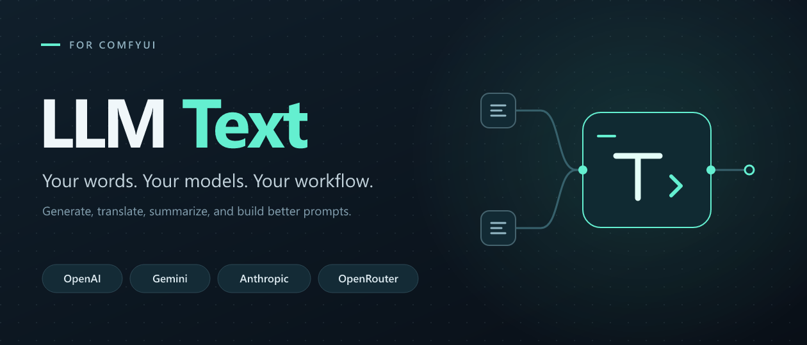

# LLM Text for ComfyUI



A text-generation node for ComfyUI with OpenAI, Gemini, Anthropic, and OpenRouter support. Turn text into prompts, translations, summaries, or other text and pass the result to the rest of your workflow as a `STRING`.

## Features

- Fetch available models and select them directly in the node.
- Customize the system prompt, output token budget, timeout, and reasoning effort.
- Remember API keys and settings separately for each provider in your browser.
- Control OpenRouter provider routing and price/throughput preferences.
- Reuse cached responses or request a new response on every execution.
- Return the final text without separate reasoning blocks.

## Installation

Requires Python 3.10 or newer and a ComfyUI installation with custom-node support.

1. Download this repository and extract it into `<ComfyUI>/custom_nodes/llm_text_node`, or clone it into that directory. The node's `__init__.py` must be directly inside `llm_text_node`, not in another nested folder.
2. Install the dependencies using **the Python environment that runs ComfyUI**:

   ```sh
   python -m pip install -r <ComfyUI>/custom_nodes/llm_text_node/requirements.txt
   ```

   Replace `python` with the appropriate interpreter if needed. For a Windows portable installation, run this from the portable installation directory:

   ```powershell
   .\python_embeded\python.exe -m pip install -r .\ComfyUI\custom_nodes\llm_text_node\requirements.txt
   ```

3. Restart ComfyUI and refresh its browser page.
4. Search for **LLM Text** when adding a node, or find it under **LLM/Text**.

To update, pull the latest changes or replace the node's files, install any updated dependencies, and restart ComfyUI and refresh the page.

## Quick start

1. Select a **Provider**.
2. Enter its **API Key**. Previously saved keys are restored automatically in the same browser.
3. Click **Fetch Models**, then choose a model from **Available Models**.
4. Enter your instructions in **System Prompt**.
5. Connect a `STRING` source to the node's `text` input. To type text directly, use ComfyUI's input-to-widget conversion.
6. Connect the `text` output to a text display node or another node accepting a `STRING`, such as CLIP Text Encode, and run the workflow.

Example system prompt for image-prompt expansion:

```text
Expand the user's idea into a concise, descriptive image-generation prompt.
Include the subject, composition, lighting, and visual style.
Return only the prompt, without explanations or quotation marks.
```

## Controls

| Control | Purpose |
| --- | --- |
| System Prompt | Instructions that guide the model's response. |
| Provider | OpenAI, Gemini, Anthropic, or OpenRouter. |
| API Key | Required credentials for the selected provider, saved in the browser and workflow. |
| Fetch Models | Retrieve the provider's current model catalog. |
| Available Models | Select the model used for generation. A saved selection is shown even before fetching the catalog again. |
| Max Output Tokens | Output budget, including reasoning tokens on some models. Default: `4096`; node range: `16–1048576`. The model may impose a lower limit. |
| Timeout (seconds) | API read timeout. Default: `120`; range: `10–1800`. |
| Reasoning Effort | Use `Minimum`, `Model default`, or an available explicit effort level. |
| OpenRouter Provider Slug | Optional comma-separated provider slugs for OpenRouter. |
| OpenRouter Routing Suffix | Default routing, throughput-first `:nitro`, or price-first `:floor`. |
| Cache Response | Reuse ComfyUI's cached result when the inputs are unchanged. Disable to request a fresh response each run. |

Only the system prompt area expands vertically when resizing the node. The API key and manual text-input areas have fixed heights.

## API keys and saved settings

### Browser storage

API keys are saved **as you type** in the browser's `localStorage`, separately for each provider. No workflow save is required for this browser-level persistence.

The node also saves the selected model, system prompt, maximum output tokens, timeout, reasoning effort, OpenRouter routing settings, and Cache Response preference. Settings are saved on widget changes and before switching providers. The external `text` input is not included in these provider preferences.

Storage entries use these names:

- `LLMText.apiKey.<Provider>` — the API key.
- `LLMText.settings.<Provider>` — the provider's settings as JSON.

These entries belong to the **browser profile and ComfyUI site origin** (scheme, host, and port). They are not synchronized to another browser or device. Clearing site data removes them. Nodes on the same origin share these saved provider preferences; they are not separate presets for each node.

Switching back to a provider restores its saved settings. When loading a workflow, browser-saved settings for that provider take precedence over the corresponding workflow values. If no preferences are saved for that provider, the workflow values remain in use. The model catalog itself is not saved; use **Fetch Models** to refresh it.

### Workflow files and key visibility

**Entered API keys are also stored in plain text in saved workflows.** Browser storage is not encrypted by this node either. The masked input is only a display feature: normally the first and last four characters are visible, while editing uses a password field.

To remove a browser-saved key, select its provider and clear **API Key**. To remove it from a workflow, save the workflow again with that field empty; previously exported copies still contain the old value. Remove entered credentials before sharing a workflow.

You can remove all saved preferences through your browser's site-data controls, or remove individual `LLMText.*` entries in the browser's developer tools under Local Storage. Removing a browser entry does not erase credentials already embedded in workflow files.

If browser storage is unavailable, the node can still retain values through workflow saving. The API key field's tooltip reports a browser-storage failure after editing.

### API requests

Enter credentials through **API Key**. The node does not read server environment variables or load `.env` files. An empty key produces an error when generating text.

API requests are made by the ComfyUI server. Keys entered in the browser are sent to that server for model discovery and generation, then used to authenticate with the selected provider.

## Reasoning effort

- **Minimum** (default): tries to minimize reasoning using the provider/model controls supported by the node.
- **Model default**: leaves the reasoning effort to the model.
- **Explicit levels**: requests the selected level; unsupported settings produce an error rather than silently changing your choice.

Selecting a different model resets reasoning effort to `Minimum`. Returning to a provider with saved settings restores its saved effort, provided it is still an available option.

For OpenAI, Gemini, and Anthropic, `Minimum` tries the lowest configured effort first. If an HTTP 400 response specifically rejects the reasoning settings, it tries the remaining configured levels and finally the model default. Connection errors, rate limits, and server errors do not trigger this fallback.

For OpenRouter, `Minimum` uses model-catalog metadata to disable optional reasoning or choose the lowest advertised non-disabled effort. If the required metadata is unavailable, it leaves the effort unspecified. Catalog metadata is cached in server memory for 15 minutes and refreshed by **Fetch Models**.

Excluding reasoning blocks from the returned text does not necessarily eliminate reasoning-token usage or cost.

## OpenRouter routing

**OpenRouter Provider Slug** accepts exact OpenRouter provider slugs, separated by commas. When specified, requests are restricted to those providers with fallback outside that list disabled. Leave it empty for OpenRouter's default routing. A provider that does not serve the selected model will cause an API error.

| Routing Suffix | Behavior |
| --- | --- |
| `Default` | Use the saved model ID without changing its suffix. |
| `:nitro` | Prefer throughput-oriented routing. |
| `:floor` | Prefer price-oriented routing. |

An explicitly selected routing suffix replaces a trailing `:nitro` or `:floor` while preserving model variants such as `:free`. Provider restrictions and routing preferences can be combined. Availability and pricing are determined by OpenRouter.

## Provider compatibility

| Provider | Generation API |
| --- | --- |
| OpenAI | Responses |
| Gemini | Interactions |
| Anthropic | Messages |
| OpenRouter | Chat Completions |

This is a text-only node. It does not provide image/audio input, tool execution, or multi-turn chat history.

Model discovery does not guarantee compatibility with the generation endpoint. OpenAI's catalog can include models that do not support Responses. Gemini's catalog is filtered for `generateContent` support, but the chosen model must also support Interactions. Older Anthropic models may not support adaptive thinking; try `Minimum` or `Model default` where appropriate.

## Troubleshooting

- **No models or authentication errors:** verify the selected provider, entered key, and account access, then fetch the models again.
- **Output token limit reached:** increase Max Output Tokens. Reasoning may share this budget. Truncated responses are reported as errors rather than returned as complete text.
- **Timeout:** increase Timeout or choose a faster model. Network and provider errors are surfaced as node errors.
- **The same response keeps appearing:** disable Cache Response to force a new API request.
- **Settings differ from a loaded workflow:** browser-saved provider preferences take precedence. Remove the relevant `LLMText.settings.<Provider>` entry to use the workflow's values.
- **Old UI after updating:** restart ComfyUI and refresh the browser page; try a hard refresh if necessary.

## License

[MIT](LICENSE).
